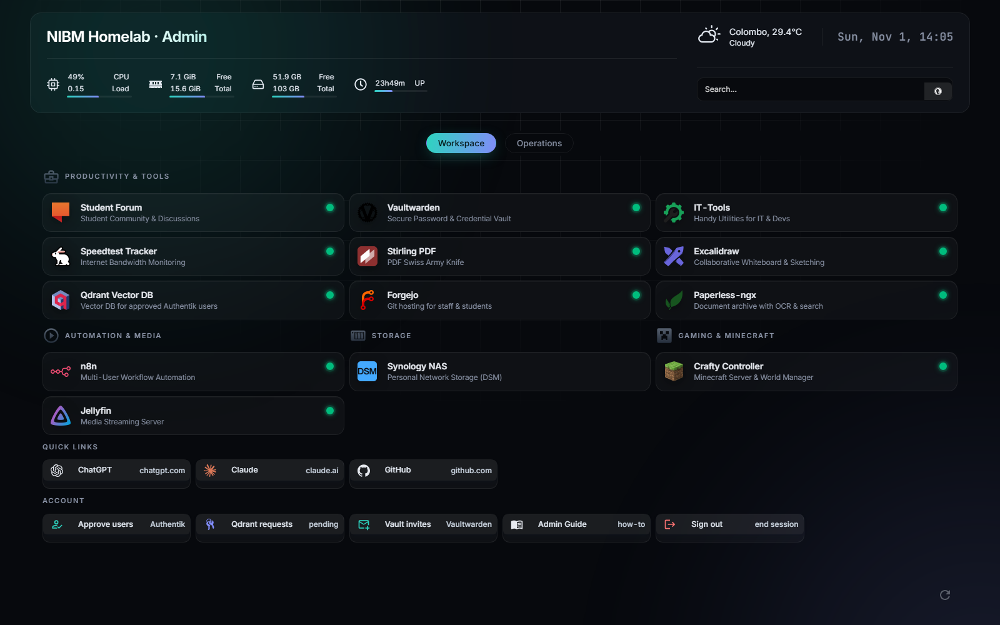
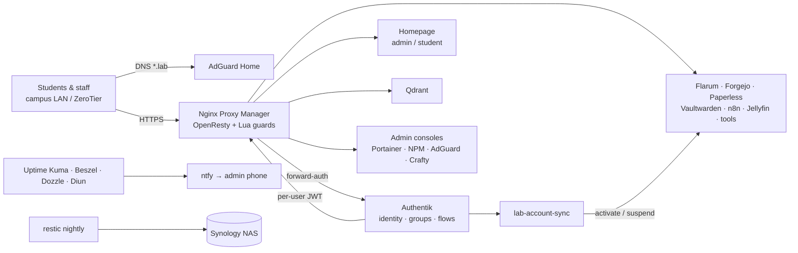
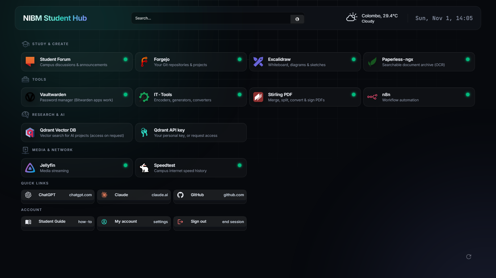
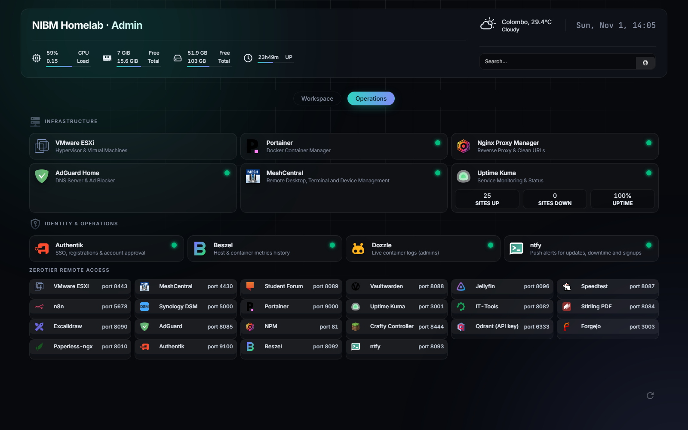
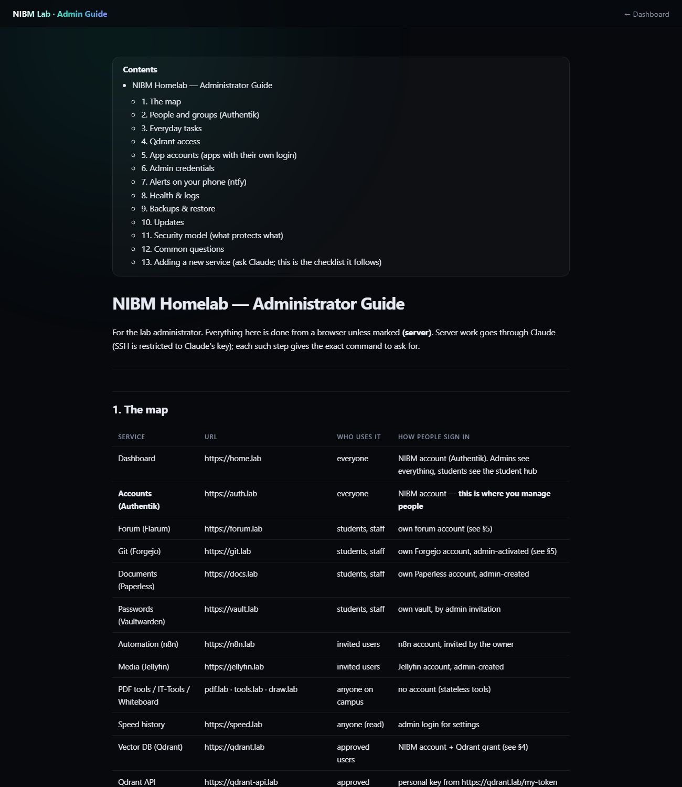

# NIBM Lab Infrastructure

**A campus-scale, self-hosted lab platform: 30+ open-source services on a single VMware ESXi VM, unified behind one identity layer, with role-based access, automated onboarding/offboarding, monitoring and encrypted backups.**

Built at the National Institute of Business Management (NIBM), Sri Lanka, by **Supun Hewagamage** ([@supunhg](https://github.com/supunhg)) during his tenure as Technical Assistant, 2026.



---

## Highlights

- **One identity for everyone.** Authentik provides self-registration with admin approval. Student usernames are their index numbers (`co…-NNN`, enforced), emails are unique, and every access decision comes from group membership.
- **Role-based dashboards on one URL.** `home.lab` serves an admin cockpit or a student hub depending on who signs in (nginx `map` on the Authentik groups header).
- **Identity-bound app accounts.** Apps with their own logins (forum, Git) only accept sign-ups whose username and email match the signed-in lab account (OpenResty/Lua guard). A sync job auto-activates matching accounts and suspends leavers.
- **Scoped, expiring API keys for the vector DB.** At each login Authentik mints a per-user Qdrant JWT (read-only, per-collection read/write, or manage) and the proxy injects it, so the master key is never exposed. Students request access through a self-service flow that alerts the admin.
- **Two locks on every admin console:** SSO gate first, then the app's own login.
- **Operations built in:** host firewall that also filters Docker-published ports, fail2ban, pinned images with update alerts, push notifications (ntfy), uptime and metrics monitoring, live logs, nightly encrypted restic backups with tested restores.
- **Everything as code.** Docker Compose, Authentik blueprints, generated proxy config, systemd units and end-to-end tests that perform real logins.

## Architecture



## What's inside

| Area | Components |
|---|---|
| Virtualisation & OS | VMware ESXi · Ubuntu 24.04 LTS · LVM · Docker |
| Network | AdGuard Home (split-horizon `*.lab`) · Nginx Proxy Manager / OpenResty · ZeroTier · Cloudflare Tunnel · iptables (`DOCKER-USER`) · fail2ban |
| Identity | Authentik (blueprints, enrollment + approval, forward-auth, expression policies, custom scope mappings) |
| Apps | Flarum · Forgejo · Paperless-ngx · Vaultwarden · n8n · Jellyfin · Qdrant · Stirling-PDF · IT-Tools · Excalidraw · MeshCentral · Crafty |
| Observability | Uptime Kuma · Beszel · Dozzle · Diun · ntfy · Speedtest Tracker |
| Data protection | restic (encrypted, deduplicated) → Synology · DB dumps · Qdrant snapshots |

## Screenshots

| Student hub | Operations view |
|---|---|
|  |  |



## Documentation

- **[Setup Guide](SETUP-GUIDE.md):** build it from scratch
- **[Admin Guide](docs/ADMIN-GUIDE.md):** day-to-day operation, from navigation to handover
- **[Student Guide](docs/STUDENT-GUIDE.md):** for end users
- **[Security findings](docs/security.md):** audit log with fixes
- **[Case study (PDF)](docs/case-study.pdf):** the project write-up

## Repository layout

```
docker-compose.yml          all services (pinned images, data under /opt/homelab/<svc>)
authentik/blueprints/       identity as code: groups, flows, policies, gates
npm/                        proxy generator + Lua (Qdrant key page, identity guard)
homepage/ homepage-student/ dashboards (shared "Graphite Aurora" theme)
host/                       firewall, SSH hardening, sysctl, systemd units
scripts/                    backup, account sync, PKI, Qdrant tokens, e2e tests
docs/                       guides and security log
```

> Addresses, network IDs and emails in this repository are placeholders. Secrets live only in the server's `.env` (see `.env.example`).

## License

MIT © 2026 Supun Hewagamage
